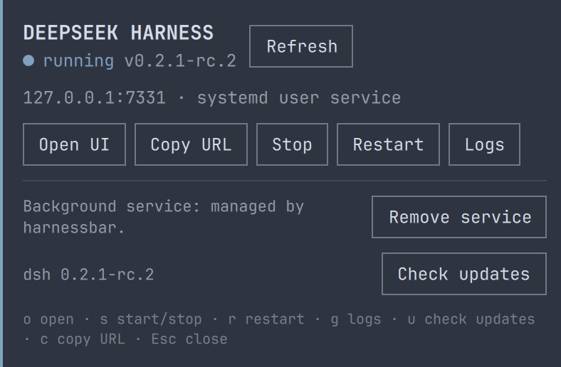

# DeepSeek Harness for Omarchy

[](https://github.com/fieldnote-ops/harnessbar/actions/workflows/validate.yml)
[](LICENSE)
[](https://omarchy.org/)

[English](README.md) | 中文

**harnessbar** 是 Omarchy 状态栏上的本地
[DeepSeek Harness](https://github.com/deepseek-ai/deepseek-harness) Web UI
（`dsh web`）管理插件。它把 `dsh web` 作为 systemd **用户服务**运行，在状态栏
直接显示健康状态与版本，提供日志、更新检查与代理设置，不用一直开着终端。



> **FIELD NOTE** 维护的独立社区项目，与 DeepSeek、Omarchy 无隶属、赞助或
> 背书关系。仅使用 DeepSeek Harness 名称说明兼容性；DeepSeek 与 Omarchy 是
> 各自权利人的商标。

## 为什么不只是一个开关？

普通开关只负责拉起进程；harnessbar 把 `dsh web` 当作服务来管理：

- **受监督**：systemd 用户单元 + `Restart=on-failure`，`omarchy restart shell`
  之后服务仍在，状态栏自动恢复连接。
- **登录自启**：可选 `systemctl --user enable`，无需终端。
- **可观测**：面板里有版本、host:port、健康状态，以及脱敏后的 journal 尾部日志。
- **可更新**：识别 mise / npm 安装方式；面板打开时会静默检查新版，显示
  当前 → 最新版本，确认后更新并重启服务。更新按发布标签判断：已安装预发布版时
  取 `latest` 与 `next` 中较新的一个（dsh 把 RC 发布在 `next`），稳定版只跟随
  `latest`，已经比所有标签都新的版本绝不会被更旧的版本覆盖。
- **代理感知**：可选的 `proxy` 设置会同时作用于服务与更新命令——在需要本地代理
  才能访问 DeepSeek API 的网络里很关键。
- **可迁移**：能识别旧的 `~/.local/bin/dsh-web*` 单元并原地修复。

## 环境要求

| 依赖 | 用途 | 说明 |
|---|---|---|
| Omarchy 4（Quattro） | 提供 shell 与状态栏 | 在 Omarchy 4.0.6 上开发与验证 |
| `dsh` | 被管理的 Web UI | 已测试 `@deepseek-ai/dsh` 0.2.1-rc.3；用 mise 或 npm 安装 |
| systemd 用户管理器 | 运行后台服务 | Omarchy 默认具备 |
| `systemd-socket-activate` | 为 **Open UI** 提供一次性登录页 | 随 systemd 提供；缺失时 Open UI 会给出明确错误 |
| `iproute2`（`ss`） | 在提供登录页前校验请求属于当前用户 | Omarchy 默认自带；缺失时 Open UI 拒绝暂存页面 |
| `jq` | 读取内联设置、格式化状态 JSON | Omarchy 默认自带 |
| `wl-clipboard` | 可选，用于「Copy URL」 | 未安装时按钮会给出明确错误 |

```sh
mise use -g npm:@deepseek-ai/dsh@latest
# 或
npm install -g @deepseek-ai/dsh@latest
```

## 安装

```sh
omarchy plugin add https://github.com/fieldnote-ops/harnessbar.git --enable --yes
```

插件会安装到
`~/.config/omarchy/plugins/io.github.fieldnote-ops.harnessbar/`，并出现在状态栏右侧。
需要移动位置时：

```sh
omarchy bar move io.github.fieldnote-ops.harnessbar --after omarchy.agents
```

> 插件在 `omarchy-shell` 内以无沙箱代码运行。启用前请阅读源码；`plugin add`
> 本身不会执行任何安装钩子。

## 首次使用

点击状态栏图标，面板会提示「服务未安装」：

1. **Install service**：从仓库自带模板写入
   `~/.config/systemd/user/dsh-web.service`，并执行 `systemctl --user daemon-reload`
   （无需 sudo）。
2. **Start**：启动 `dsh web`，把带 token 的启动 URL 写入权限为 600 的运行时文件，
   并显示健康状态。修改 `startOnLogin` 后，用同一行的 **Re-apply unit** 应用。
3. **Open UI**：用 Omarchy Web App 窗口（或默认浏览器，取决于 `openMode`）打开 UI。

等价的终端操作：

```sh
HB=~/.config/omarchy/plugins/io.github.fieldnote-ops.harnessbar/bin/harnessbar
"$HB" setup-service
"$HB" start
"$HB" status
```

## 设置

设置存放在 `~/.config/omarchy/shell.json` 中本插件的条目里。面板的
**Settings → Edit** 表单对非敏感项使用 `omarchy bar set`；代理则通过
stdin 传入 helper，写入 0600 私有文件后再用 `jq --rawfile` 更新 `shell.json`，
因此含 `user:password` 的代理不会出现在任何进程参数中。CLI 用法等价。
修改 `port` 或 `proxy` 后需要 **Restart**；`startOnLogin` 在保存设置时立即生效
（也可用 **Re-apply unit**）。

代理默认是**空（直连）**，只有网络需要本地代理时才设置；文档示例使用通用端口。
代理 URL 若包含账号密码，会以明文存入 `shell.json`（本机用户与工具可读），
共享机器上请避免使用。面板通过 stdin 传递代理，helper 先写入 0600 私有文件；
dsh 更新命令则通过环境变量接收代理，而不是 argv。

| 键 | 类型 | 默认值 | 含义 |
|---|---|---|---|
| `port` | integer | `3080` | `dsh web` 监听端口；`0` 表示由系统分配 |
| `proxy` | string | `""` | 可选 HTTP(S) 代理，作用于服务与更新检查，如 `http://127.0.0.1:8080` |
| `dshPath` | path | `""` | 可选 `dsh` 绝对路径；留空自动探测 mise、`PATH`、`~/.local/bin` |
| `openMode` | enum | `Webapp` | `Webapp` 用 `omarchy-launch-or-focus-webapp`；`Browser` 用 `xdg-open` |
| `startOnLogin` | enum | `Off` | 面板/CLI 保存后立即应用（`On` 执行 `systemctl --user enable`），或由 **Re-apply unit** 应用 |
| `refreshSec` | integer | `5` | 状态轮询间隔（秒） |
| `glyph` | string | `󰚩` | 状态栏 Nerd Font 图标；填 `DS` 可用纯文字标签 |

```sh
omarchy bar set io.github.fieldnote-ops.harnessbar proxy http://127.0.0.1:8080
omarchy bar set io.github.fieldnote-ops.harnessbar port 3080 --json
omarchy bar set io.github.fieldnote-ops.harnessbar startOnLogin On
```

## 使用

| 操作 | 效果 |
|---|---|
| 左键 | 打开/关闭面板 |
| 右键 | 未运行则先启动，然后打开 Web UI |
| 中键 | 刷新状态 |
| `o` / `c` / `s` / `r` / `g` / `u` | 打开 UI / 复制 URL / 启停 / 重启 / 日志 / 检查更新 |
| `Esc` | 关闭面板 |

停止、重启、更新、接管（Adopt）、移除服务等破坏性操作都会先弹出确认。**Stop** 只对 harnessbar 管理的单元开放，legacy 单元需先修复。**Copy URL 复制的是凭据**：
URL 里带有每次进程唯一的启动 token。

也可以走 shell IPC（适合绑定快捷键或脚本）：

```sh
omarchy-shell shell call io.github.fieldnote-ops.harnessbar toggle ''
omarchy-shell shell call io.github.fieldnote-ops.harnessbar refresh ''
```

仓库内的 helper CLI 支持全部操作、日志、更新检查与服务安装；运行
`bin/harnessbar help` 查看。

## 服务与文件

| 路径 | 用途 |
|---|---|
| `~/.config/systemd/user/dsh-web.service` | harnessbar 管理的单元（可检查；由 Remove service 删除） |
| `$XDG_RUNTIME_DIR/harnessbar/url` | 仅属主可读（600）的启动 URL，服务停止时删除 |
| `journalctl --user -u dsh-web.service` | 服务日志；面板展示时会屏蔽 token |
| `~/.dsh/` | DeepSeek Harness 数据（会话、设置、凭据），本插件**从不修改** |

单元名特意保持 `dsh-web.service`，这样旧的本地 helper 配置会被识别并修复，而不是
并存两个服务。

## 安全说明

- 与所有 Omarchy 插件一样，本插件在 `omarchy-shell` 内无沙箱运行。
- 不使用 `sudo`/`pkexec`，不写系统级文件，不下载并执行远程代码。
- 服务是普通 systemd **用户**单元，不会在用户登出后继续运行。
- 启动 URL 是凭据：只存放在 `$XDG_RUNTIME_DIR`（600），不打印进 journal、不在
  面板中明文展示，只有你主动点击 Copy 才复制。请同样注意截图、剪贴板历史与日志分享。
- **Open UI 不会把 token 放进进程参数**：它由一次性回环监听器
  （`systemd-socket-activate`，地址 `127.0.0.1:<随机端口>/<随机路径>`）提供私有登录页，
  只把该 URL 交给启动器，页面再跳转到带 token 的 URL。因此 helper、转义子进程、
  启动器和浏览器的 `/proc/<pid>/cmdline` 里都没有凭据；token 仍会出现在浏览器
  地址栏/历史中（这是打开页面本身所必需的）。
- **登录页会校验调用方身份**：该 URL 本身是凭据——谁能取到页面谁就拿到 token。由于启动器通过
  argv 收到该 URL（其他本机用户可读），监听器会用 `ss -tnpe` 把自己的连接四元组反过来查对端
  socket：只有对端与四元组精确匹配且属主 uid 是当前用户时才返回页面；缺失或存在多个匹配一律
  `403`，且不消耗页面。同一 uid 的进程仍可获取，但它本来就能读 0600 的 URL 文件。
- **为什么不用 `file://` 页面**：`dsh web` 的会话 cookie 带 `SameSite=Strict`，
  Chromium 不会在由本地文件发起的跳转中发送它，页面会停在 dsh 的 401 上。改从
  `127.0.0.1` 提供页面（端口不影响同站判定）后 cookie 才能生效。监听器只响应那条
  随机路径一次，其余请求返回 404，服务完成后立即停止（浏览器没来则约 20 秒后停止）。
- **从 0.2.1 或更早版本升级**：旧插件启动的浏览器进程可能仍把旧 token 留在其进程参数中，
  直到该浏览器进程退出。关闭 DeepSeek Harness 窗口/浏览器后从面板重新打开即可消除；
  重启 `dsh-web.service` 也会让旧 token 失效。新打开的窗口始终走私有回环登录页。
- 更新操作复用你已有的 mise/npm，不会静默下载；只会安装严格更新的已发布版本，
  发现当前版本比 `latest` 新时不会降级。
- Omarchy 自动安全基线会报告本插件有意使用的能力：`service-management`
  （systemd 用户单元）与 `package-manager`（mise/npm 更新动作），以及来自
  否定性文档的 `privilege` 和来自开发章节 clone 命令的 `remote-build`。这些行为
  在本文档中公开说明。

## 卸载

1. 面板 → **Remove service**（停止、禁用并删除单元；`~/.dsh` 数据不受影响），或：
   ```sh
   ~/.config/omarchy/plugins/io.github.fieldnote-ops.harnessbar/bin/harnessbar remove-service
   ```
2. 移除插件：
   ```sh
   omarchy plugin remove io.github.fieldnote-ops.harnessbar --yes
   ```
3. 若从旧本地配置迁移而来，可自行删除残留的 `~/.local/bin/dsh-web` 与
   `~/.local/bin/dsh-web-run`；harnessbar 不会删除自身单元以外的文件。

## 故障排查

- **提示 `dsh not found`**：安装 `dsh`，或设置 `dshPath`。
- **服务启动失败 / 面板报错**：打开 **Logs**，或执行
  `journalctl --user -u dsh-web.service -n 100`。
- **代理环境下模型调用失败**：设置 `proxy` 后重启服务。
- **端口被占用**：换一个 `port`（或 `0`）后重启。
- **检测到 legacy 服务**：面板 → **Repair service** 重写为插件管理的单元，之后
  Restart 生效。

更多见 [docs/troubleshooting.md](docs/troubleshooting.md) 与
[docs/architecture.md](docs/architecture.md)。

## 开发

```sh
git clone https://github.com/fieldnote-ops/harnessbar.git
cd harnessbar
bash tools/preflight.sh      # manifest + 测试 + QML 检查
git config core.hooksPath .githooks   # 可选：push 前自动 preflight
```

测试通过 stub 模拟 `systemctl`、`dsh`、`npm`、`mise`、`journalctl` 与启动器，
因此无需真实服务即可在任何机器上运行；`qmllint` 可用时会检查 QML。CI 在
Ubuntu 上运行同一套门禁。

## 兼容性

已在 Omarchy 4.0.6（Quattro）与 `@deepseek-ai/dsh` 0.2.1-rc.2 上完成真机验证
（2026-10-20）：非零状态栏槽位、面板开合、实时状态、legacy 单元识别与一次原地
服务修复。生命周期动作由 stub systemd 测试覆盖；开发期间未重启承载当前 GUI 的
线上服务。插件依赖 `dsh web` 的文档化启动契约：`dsh web:` 行是就绪信号，
URL 带进程 token，`--port 0` 表示自动选端口。只要 DSH 继续打印该行就能工作；
否则面板会报告明确错误而不是猜测。

## 许可证

MIT — 见 [LICENSE](LICENSE)。© 2026 FIELD NOTE。

[](https://github.com/deepseek-ai/deepseek-harness)
